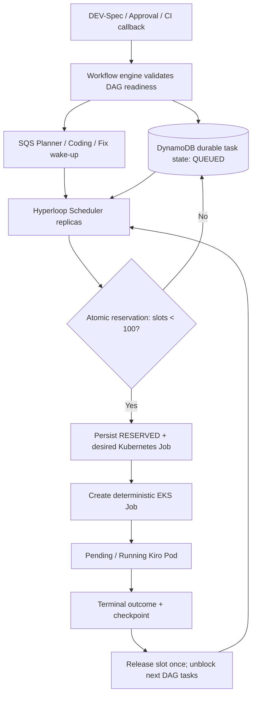

# Hyperloop Cloud — Codex Engineering Handoff

**Status:** v1.2 implementation blueprint — contracts/CP/agent/integrations SDD-only core in progress (M0–M4 + Section 15 gates)
**Revision:** 2026-10-27 — v1.2: self-contained `*-sdd` planning context, SDD completeness and revision gates; retains M1.5 concurrency management
**Target:** AWS EKS + DynamoDB + S3 + GitLab + existing Jenkins + private Nexus + Microsoft Teams
**AI runtime:** Kiro CLI headless only. Codex is used to build the platform, not as a production runtime.

## 1. Immutable product decisions

1. DEV-Spec submission to project SDD repository starts planning (not coding).
2. Control Plane resolves explicitly declared target services from the **pinned `*-sdd` repository** and schedules a **Planner Kubernetes Job**. Jira, Confluence, Graphify and external service catalogs are **not required planning runtime dependencies**.
3. Planner produces a versioned Implementation Spec, service dependency DAG, and job contracts.
4. Mandatory human approval of exact Implementation Spec hash/revision before coding.
5. Control Plane schedules ephemeral Coding Jobs, normally one per affected repository, respecting DAG dependencies.
6. Each Coding Job checks out the **DEV-Spec-specified working branch**, implements changes with Kiro CLI, commits/pushes, and creates or updates an MR targeting the **DEV-Spec-specified release/x.y.z branch**.
7. Coding Job writes durable outputs and exits; Kubernetes cleans up Job/Pod after TTL.
8. Existing Jenkins pipeline performs quality checks. Its callback to Hyperloop is correlated by workflow, repository, MR, and commit SHA.
9. Control Plane consults DynamoDB checkpoint and policy, creates a **new Fix Job** if eligible. Max **two automatic fix attempts per service execution** after initial coding.
10. Each Fix Job works on the same MR source branch, pushes a new commit, exits, and Jenkins runs again.
11. On pass: mark MR ready for human review; on non-fixable failure/retry exhaustion: NEEDS_HUMAN via Teams.
12. Final completion requires GitLab merge event, not merely successful CI.
13. All agent images pulled from **private Nexus**; no separate LLM/model API.
14. **Global admission limit: 100 outstanding Agent Job reservations** (RESERVED/SCHEDULED/PENDING/RUNNING); further ready work stays QUEUED durably.
15. **SQS provides wake-up/backlog delivery, DynamoDB owns durable ready-work state, reservations and checkpoint records.** A multi-replica scheduler uses atomic conditional writes; never count Running Pods to enforce admission.
16. Planner, Coding and Fix have separate SQS wake-up queues with shared global capacity, soft fairness policies and reconciliation. No long-lived Kiro workers.
17. The `*-sdd` repository is the **single source of truth for approved requirements, analysis, design, DEV-Spec, service mapping and branch contracts**. Planner reads only the pinned SDD revision to build its implementation plan; Coding/Fix additionally read their specified source repositories.
18. An **SDD completeness gate** blocks planning if required documents, service mapping or branch contracts are missing. Planner cannot silently expand the approved repository scope.
19. HITL approval is bound to the exact SDD commit SHA and Implementation Spec content hash. A relevant SDD revision change invalidates or supersedes stale planning/approval; running jobs must be fenced before further push.

## 2. Repository layout

### A. hyperloop-contracts (P0)
```
contracts/
  schemas/sdd-manifest.schema.json
  schemas/dev-spec.schema.json
  schemas/implementation-spec.schema.json
  schemas/workflow-event.schema.json
  schemas/agent-job-request.schema.json
  schemas/agent-result.schema.json
  schemas/ci-result.schema.json
  schemas/approval-decision.schema.json
  examples/sdd-manifest.yaml
  examples/dev-spec.yaml
  examples/implementation-spec.yaml
  examples/ci-result.json
  openapi/control-plane.yaml
  asyncapi/events.yaml
  versioning.md
```
Implement: JSON Schema validation; event envelope (`eventId`, `eventType`, `occurredAt`, `workflowId`, `correlationId`, `schemaVersion`); contract compatibility tests; error codes. Freeze v1 schemas before integrating services.

### B. hyperloop-control-plane (P0)
Suggested stack: TypeScript + Node.js (Fastify), AWS SDK v3, Kubernetes JS client, Zod/Ajv; alternatively Java/Spring Boot if team standard dictates. Keep orchestration logic framework-agnostic.
```
src/
  api/                 # webhooks, workflow read, approval, admin endpoints
  domain/              # state machine, transitions, retry policies, DAG
  sdd/                 # SDDContextLoader, SDDCompletenessValidator, SDDServiceResolver, SDDRevisionManager
  planning/            # SDDDependencyValidator, PlanConsolidationService, PlanningCoordinator
  application/         # commands, orchestrator, reconciliation
  adapters/dynamodb/   # conditional updates, outbox
  adapters/kubernetes/ # Job create/watch/delete
  adapters/s3/         # artifacts
  adapters/gitlab/     # interfaces
  adapters/jenkins/    # interfaces
  adapters/teams/      # interfaces
  workers/             # queue consumers, reconciliation
  scheduler/           # durable ready-work dispatch, fairness, admission
  capacity/            # DynamoDB semaphore and per-job reservations
  security/            # authn/authz, policy
  telemetry/           # logs, traces, metrics
migrations/            # DynamoDB IaC/table definitions
integration-tests/
Dockerfile
```
**Implement:**
- POST /webhooks/gitlab/sdd: verify webhook secret/signature as supported by GitLab deployment, dedupe event, validate changed path and DEV-Spec status, pin SDD commit SHA; enqueue/start workflow.
- Validate the self-contained SDD package at that SHA (document paths, declared repositories, branch contracts, allowed targets). On missing required inputs transition to `NEEDS_SPEC_CLARIFICATION` instead of guessing from Jira/Confluence.
- `SDDServiceResolver` reads declared service targets; `SDDDependencyValidator` checks dependency references, topological order and cycles; `PlanConsolidationService` validates Planner output against SDD scope.
- `SDDRevisionManager` handles repeated pushes: dedupe by commit/path, supersede stale plans, invalidate approvals when approved inputs change, and fence obsolete agent jobs from pushing.
- POST /webhooks/jenkins/ci: authenticate, validate source and correlation, reject stale commit results, idempotently apply CI result.
- POST /webhooks/gitlab/mr: verify merge state and finalize workflow.
- POST /workflows/{id}/approve-spec: authorized approver + expected version/hash + decision; conditional state transition.
- POST /workflows/{id}/cancel, /resume; GET /workflows/{id}, /timeline, /artifacts.
- State machine; per-service DAG scheduler; concurrency quotas; job reservation; cancellation; timeout; retries; recovery reconciler.
- Kubernetes Job builder with resource requests/limits, activeDeadlineSeconds, backoffLimit=0, ttlSecondsAfterFinished, node affinity, ServiceAccount, Pod Identity, imagePullSecrets, securityContext.
- Durable state and outbox: **persist desired job intent before Kubernetes create**; reconciler repairs incomplete create/watch/record steps. Do not rely on single in-memory leader.
- Persist approval audit and CI history. Event dedupe by eventId/delivery id plus domain keys.

### C. hyperloop-agent-runtime (P0)
```
images/kiro-agent/Dockerfile
entrypoint/run-agent.sh
src/runner/            # validate contract, checkout, hydrate context, invoke Kiro
src/roles/planner/
src/sdd/               # pinned SDD clone, manifest/document loader, completeness checks
src/roles/coding/
src/roles/fix/
src/git/               # branch, commit, push, MR idempotency
src/artifacts/         # S3 reports, results
src/security/          # credentials, scrub secrets
skills/                 # approved Kiro skills/prompts
contracts/              # pinned schema dependency
tests/
```
**Planner:** clone only the pinned `*-sdd` revision; load requirement, analysis, design, DEV-Spec, acceptance criteria and declared service/branch mappings from that repository; produce Implementation Spec and DAG; flag missing scope or inconsistent dependencies. Do **not** call Jira, Confluence, Graphify or external service catalog as mandatory runtime context. Never create Pods, mutate scope or push code.
**Coding:** checkout repo and exact working branch; verify target release branch exists and approved spec hash matches; invoke Kiro CLI headless with role-specific skills; run preflight checks; commit/push with workflow marker; create/update MR idempotently; upload result (`commitSha`, `mrIid`, `branch`, `artifacts`).
**Fix:** fetch exact failed CI result and logs; ensure source branch HEAD matches expected commit; invoke Kiro on bounded fix scope; commit/push to same branch; update MR; upload result. No new MR.
**All roles:** process exit code; bounded runtime; graceful SIGTERM handling; upload checkpoint before successful exit; secrets not written to logs. Validate actual installed Kiro CLI headless flags/session behavior in a spike; never assume session portability between Pods.

### D. hyperloop-integrations (P0)
```
src/gitlab/        # SDD webhook parser, pinned SDD fetch, GitLab API, branch/MR operations
src/jenkins/       # webhook receiver/client, pipeline correlation
src/identity/      # Jira/GitLab/Entra user mapping interfaces
src/common/        # signed callback, idempotency, retries
contracts/
tests/fixtures/
```
Implement: GitLab project/repo allowlists, protected branch rules, MR create-or-update, status lookup, commit comparison, Jenkins result contract (job, build, MR, repo, SHA, quality gate failures, log/report links), signature/token verification, stale/out-of-order callback handling. Jenkins integration should be a **small shared-library/post-build hook** added to existing pipelines; do not replace CI.

### E. hyperloop-infrastructure (P0)
```
terraform/aws/         # DynamoDB, S3, SQS optional, IAM/Pod Identity, monitoring
helm/control-plane/
helm/agent-job/         # Job template used by controller, not installed as always-on workload
helm/teams-gateway/
k8s/namespaces/
k8s/rbac/
k8s/network-policies/
k8s/karpenter/
ci/                    # build/push to private Nexus, deploy
runbooks/
```
Implement: EKS namespaces (`hyperloop-system`, `hyperloop-agents`); dedicated Karpenter node pool for agents; minimum-privilege Kubernetes RBAC; IRSA/Pod Identity; Nexus pull secret or supported credential provider; private network path to Nexus/GitLab/Jenkins; NAT/proxy to Kiro service endpoints as required; DynamoDB conditional writes/PITR; S3 encryption/lifecycle; CloudWatch logs/metrics; alerting; separate dev/staging/prod configs.

### F. hyperloop-teams-gateway (P1)
```
src/bot/               # Microsoft Bot/Teams SDK adapter
src/cards/             # spec approval, needs human, MR ready
src/commands/          # callback authz, action -> Control Plane
src/conversations/     # user/conversation mapping
src/security/
tests/
```
Implement: proactive 1:1 notification; spec approval card showing immutable spec hash and review link; authorized approve/reject; callback idempotency; escalation after fix exhaustion; action audit. Teams Gateway is not workflow state owner.

## 3. DEV-Spec v1 proposed example
```yaml
apiVersion: hyperloop.dev/v1
kind: DevelopmentSpec
metadata:
  project: transaction-banking
  userStory: PAY-1234
  revision: 1
spec:
  status: submitted
  requirements: [02-requirements/PAY-1234/US.md]
  analysis: [03-designs/PAY-1234/analysis.md]
  designs: [03-designs/PAY-1234/solution-design.md]
  acceptanceCriteria: [04-development/PAY-1234/acceptance-criteria.md]
  targets:
    - repository: coc-ewallet-service
      workingBranch: feature/PAY-1234
      targetBranch: release/2.5.0
    - repository: access-control-adapter
      workingBranch: feature/PAY-1234
      targetBranch: release/2.5.0
  execution:
    requireSpecApproval: true
    maxAutoFixAttempts: 2
```
The real DEV-Spec may already have a schema; adapt rather than overwrite existing project conventions. Validate exact branch fields and target release branch policy before execution.

## 4. State model and transition guards

Workflow: `SUBMITTED -> PLANNING -> WAITING_SPEC_APPROVAL -> CODING -> AWAITING_CI -> READY_FOR_REVIEW -> MERGED -> COMPLETED`.
Exceptions: `SPEC_CHANGES_REQUESTED -> PLANNING`; `AWAITING_CI -> FIXING -> AWAITING_CI`; `NEEDS_HUMAN`, `CANCELLED`, `FAILED`.

Per-service execution is tracked independently. Workflow becomes READY_FOR_REVIEW only when all required service MRs pass CI; cross-service ordering follows DAG.

Guards:
- `approveSpec`: approver authorized, status waiting, approved hash equals current immutable spec hash, expected version matches.
- `startCoding`: approval exists for current spec hash, branches and repositories allowlisted, no active duplicate job.
- `acceptCi`: repo/MR/source commit SHA match current expected SHA; duplicate events no-op; old callbacks recorded as stale.
- `scheduleFix`: failure classified fixable, no concurrent fix, `autoFixAttempts < 2`; atomic increment/reservation in DynamoDB.
- `complete`: GitLab merge events confirmed for every required MR; do not equate green CI with merged code.

## 5. DynamoDB table proposal

Prefer one table `hyperloop-workflows` with PK/SK and conditional writes; alternatively separate tables if access patterns justify.

| PK | SK | Content |
|---|---|---|
| `WF#PAY-1234#<revision>` | `META` | status, specHash, SDD SHA, version, owner |
| same | `SERVICE#coc-ewallet-service` | repo, branches, MR, expectedCommitSha, fixAttempts, state |
| same | `CHECKPOINT#<stage>#<timestamp>` | S3 artifact URI, stage, job UID, status |
| same | `APPROVAL#<decisionId>` | approver Entra ID, specHash, decision, time |
| same | `CI#<repo>#<buildId>` | pipeline, commit, status, report URI |
| same | `EVENT#<eventId>` | idempotency marker |
| same | `JOB#<jobId>` | desired Job spec hash, Kubernetes UID, observed status |

Use GSI for `status + updatedAt` workflow listing and `MR/project` correlation; TTL only on ephemeral event dedupe entries, **not** on durable workflow audit records. DynamoDB stores metadata; S3 stores specs/logs/reports; Git stores code. Use optimistic versioning and transactional/conditional writes for critical transitions.

## 6. API / event contracts (minimum)

Inbound:
- `gitlab.sdd.dev_spec_submitted.v1`: project, SDD commit SHA, path, revision, eventId; newer relevant revisions must supersede stale plans and approvals.
- `hyperloop.spec_decision.v1`: workflowId, approvedSpecHash, approver, decision, expectedVersion.
- `jenkins.ci_completed.v1`: workflowId, repo, mrIid, commitSha, pipelineId, status, gateFailures[], reportUri.
- `gitlab.mr_merged.v1`: repo, mrIid, mergeCommitSha, targetBranch.

Outbound:
- `agent.job_requested.v1`: workflowId, stage, repo, approvedSpecHash, inputArtifactUris, branch contract, attempt.
- `agent.job_completed.v1`: jobId, stage, exitStatus, outputArtifactUris, commitSha?, mrIid?, errorCode?.
- `hyperloop.notification_requested.v1`: workflowId, recipient, type, action token reference.

All callbacks must authenticate sender, be idempotent, and use explicit versioned schemas. Use SQS for ingress buffering if already approved; it is not the workflow engine. Ack queue messages after durable workflow/job intent persistence, not after agent completion.

## 7. Kubernetes Job lifecycle

1. Orchestrator persists `JOB_DESIRED` with unique job key.
2. Controller creates Kubernetes Job with deterministic name/labels and owner workflow identifiers.
3. Pod pulls pinned image digest from private Nexus; checkout code and hydrate context.
4. Agent runs Kiro CLI, uploads artifacts, commits/MR when applicable, writes result.
5. Container exits; Kubernetes Job becomes Complete/Failed.
6. Watcher/reconciler observes outcome and advances DynamoDB state.
7. TTL controller deletes finished Job/Pod; Karpenter can consolidate idle agent nodes.

Set `restartPolicy: Never`, `backoffLimit: 0`, `activeDeadlineSeconds`, `ttlSecondsAfterFinished`; no long-lived agent pods. On crash after Git push but before checkpoint, reconciler queries GitLab by workflow marker/branch/MR to avoid duplicate commits or MRs.

## 8. Security and policy gates

- Restrict repo/project allowlists and source/target branch naming; never allow agent to push to protected release branch directly.
- Dedicated short-lived credentials (GitLab project access token or workload identity mechanism), least-privilege permissions, secret redaction.
- No cluster-admin for agent pods; ideally agent SA cannot create Jobs or read workflow table broadly.
- GitLab MR approvals and Jenkins quality gates remain authoritative.
- Verify Teams approver identity and authorization server-side; do not trust Adaptive Card fields.
- NetworkPolicies restrict agent egress; pin images by digest; scan Nexus images.
- Avoid executing untrusted repo instructions as privileged operations; sandbox workspace and restrict credentials.

## 9. Milestones / Codex execution order

**M0 — Contracts and test fixtures**: schemas, examples, transition rules, OpenAPI, integration fixtures. Acceptance: all schemas validate; invalid branch/approval payloads rejected.

**M1 — Control Plane skeleton**: HTTP endpoints, DynamoDB repository, workflow transitions, idempotency, local mocks. Acceptance: submit -> plan desired -> waiting approval persisted; duplicate event no duplicate workflow.

**M1.5 — Queue & Concurrency Management (mandatory before M2)**: 3 SQS queues + DLQs, durable DynamoDB ready-work state, global 100-slot atomic admission, multi-replica scheduler, slot reclamation/reconciliation, fairness, metrics and load tests. Acceptance: 150 simultaneous requests yield <=100 active reservations including Pending pods; remaining 50 queued; controller crash and duplicate delivery cannot lose work or exceed cap.

**M2 — SDD-only Planner Job vertical slice**: SDD completeness gate, pinned SDD clone, manifest/document loader, Kiro runner, Nexus image, EKS Job builder/watcher, S3 outputs. Acceptance: valid self-contained DEV-Spec creates planner pod and reviewable plan without Jira/Confluence/Graphify; incomplete SDD yields NEEDS_SPEC_CLARIFICATION and no Planner Job.

**M3 — HITL**: approval API, Teams card or temporary authenticated approval UI, hash binding, audit. Acceptance: no coding before approval; changed spec invalidates approval.

**M4 — Coding Job / GitLab MR**: branch checkout, Kiro codegen, commit/push, idempotent MR, TTL cleanup. Acceptance: approved plan -> new pod -> MR to release branch -> pod terminates.

**M5 — Existing Jenkins integration**: CI callback, correlation by SHA, stale result filtering. Acceptance: green CI marks ready; red CI transitions to fix decision.

**M6 — Fix loop**: bounded new Fix Jobs, same MR branch, new commit, CI rerun, escalation. Acceptance: exactly two automatic fixes maximum; no double scheduling on duplicate callback.

**M7 — Production hardening**: Karpenter, advanced per-project quotas, observability, secrets, security, disaster recovery, scale/load testing. Acceptance: pod/controller crash recovery without duplicate MR/fix; cancellation and timeout safe.

## 10. Tests Codex must write

Unit: state transitions, DAG topological ordering, approval hash, retry budget, stale CI SHA, branch validation, error classification.
Integration: DynamoDB Local/test table, mocked Kubernetes API, GitLab/Jenkins HTTP fixtures, S3 mock/test bucket, webhook authentication.
E2E UAT: 2-repo DEV-Spec -> planner -> approval -> parallel/dependent coding -> 2 MRs -> Jenkins fail -> Fix Job -> Jenkins pass -> review -> merge -> COMPLETED.
Chaos: duplicate webhook, out-of-order Jenkins events, orchestrator restart during job creation, agent dies after Git push, CI never returns, approval after spec revision changes, two approvers click simultaneously.

## 11. What NOT to build in v1

- New CI engine (reuse Jenkins).
- Separate LLM gateway/model API (Kiro CLI only).
- Always-on Kiro worker pool.
- KEDA ScaledJobs for each DAG stage (Control Plane schedules Jobs directly).
- Multi-region active-active orchestration.
- Custom Git hosting or container registry (reuse GitLab/Nexus).
- Autonomous merge to release branch (retain human MR approval).

## 12. Copy/paste Codex bootstrap prompt

> You are implementing Hyperloop Cloud from this engineering handoff. Start with `hyperloop-contracts` and `hyperloop-control-plane` only. First produce an ADR for stack choices and a dependency graph, then scaffold a compilable repository with unit tests and CI. Implement workflow states, conditional DynamoDB persistence, idempotent DEV-Spec webhook intake, and a Kubernetes Job scheduling interface with a fake adapter. After M1, implement M1.5 with durable DynamoDB job intents, 3 SQS queues and DLQs, a strict 100-slot concurrency semaphore, reservation recovery, fairness and multi-replica load tests before any real Planner Jobs. Do not implement a separate AI model API; production agents will use Kiro CLI. Do not invent real GitLab, Jenkins, AWS, Nexus, or Teams credentials. Preserve spec approval before coding, maximum two auto-fix attempts, and target release branch specified in DEV-Spec. Deliver a README with local setup, `.env.example`, Dockerfile, test commands, and an acceptance checklist. Stop after M1 and report open decisions before moving to M2.

## 13. Open decisions to confirm with engineering

- Primary implementation language (TypeScript vs Java) and company runtime baseline.
- DEV-Spec canonical schema/path and semantics of "submitted" vs "approved".
- Branch ownership if developer branch already exists or has unrelated commits.
- GitLab authentication/token rotation and MR review policy.
- Jenkins callback mechanism (post-build hook vs GitLab pipeline status listener).
- Source-code network connectivity and Kiro CLI authentication in isolated EKS pods.
- Whether spec approval happens only in Teams or also through GitLab approval.
- CI gate taxonomy: fixable code failures vs infrastructure/security/policy failures requiring immediate escalation.


## 14. M1.5 — Queue, Scheduler and Global Concurrency (IMPLEMENT BEFORE M2)

### 14.1 Non-negotiable semantics

- Maximum **100 admitted Agent Jobs globally**, where admitted includes `RESERVED`, `SCHEDULED`, Kubernetes `Pending` and `Running`. This is an **admission cap**, not a guarantee that 100 pods are Running; EKS quota, node capacity and scheduling constraints may lower actual concurrency.
- Waiting work stays in DynamoDB `QUEUED` and must not create Kubernetes Jobs or consume an admission slot.
- A service DAG task becomes ready only when dependencies and required spec approval are satisfied. `WAITING_SPEC_APPROVAL` is not ready to dispatch.
- Separate `planner`, `coding`, `fix` SQS standard queues (with DLQs) carry **wake-up hints**, not the sole source of truth. At-least-once and out-of-order delivery are expected; deduplicate using stable task IDs and workflow versions.
- Do not hold SQS messages invisible for the entire queue wait or Kiro runtime. Acknowledge only after a durable state/intent exists; periodically scan DynamoDB ready work so a lost wake-up cannot strand a task.
- Scheduler owns Kubernetes Job creation; agent pods never receive permission to create jobs or modify global quota.

### 14.2 Reference scheduling flow



### 14.3 DynamoDB entities and atomicity

Suggested entities (single-table or separate tables acceptable if transactionally consistent):

| Entity | Key / fields | Purpose |
|---|---|---|
| `CAPACITY#GLOBAL` | `limit=100`, `used`, `version` | Global semaphore |
| `TASK#<taskId>` | `workflowId`, `stage`, `repo`, `priority`, `readyAt`, `status`, `attempt`, `version` | Durable dispatch source |
| `RESERVATION#<taskId>#<attempt>` | `state`, `k8sJobName`, `createdAt`, `lastObservedAt`, `releasedAt` | Idempotent slot ownership |
| `WORKFLOW#<workflowId>` | spec hash, DAG, approval, status | Workflow authority |
| `OUTBOX#<eventId>` | destination, payload, status | Retryable event publication |

**Reserve transaction** (`TransactWriteItems`): conditionally increment global `used` only if `used < 100`; condition task `status=QUEUED` with expected version; write unique reservation `attribute_not_exists(pk)`; update task to `RESERVED` with deterministic Kubernetes Job name and immutable execution contract. Transaction failure means **do not create a Kubernetes Job**. If using DynamoDB counters, express bounds in a condition against the current item (`used < :limit`) and keep capacity limit changes controlled; do not implement a read-then-write counter.

**Release transaction**: condition reservation `state=ACTIVE` (or unreleased) and terminal evidence; set `RELEASED`, decrement `used` exactly once, advance task state, emit outbox event. Duplicate watcher events must not double decrement. Never let TTL deletion of reservation records release capacity: DynamoDB TTL is asynchronous and not an execution coordinator.

**Crash safety**: Persist `RESERVED` + desired Job before calling Kubernetes. Reconciler lists deterministic Job name/labels and creates missing Jobs; if a create timed out, query before retrying. If scheduling cannot recover, mark failed/abandoned using explicit policy and release slot transactionally. Use an idempotent terminal finalizer to reconcile Agent result, S3/GitLab side effects and Kubernetes state before releasing. A lost scheduler heartbeat **alone** is not proof the Kubernetes Job stopped: do not release a slot while an old Job can still run. Handle `NotFound` only after verifying desired-state and execution ownership.

### 14.4 Scheduler algorithm and fairness

- Dispatch only DAG-ready tasks; default priority `fix=100`, `coding=50`, `planner=10`.
- Initial **soft** distribution targets: Fix 20, Coding 65, Planner 15, summing to 100. **Not hard partitions:** unused slots can be borrowed by any class, subject to global cap.
- Add waiting-time aging and per-project/per-repo caps to prevent starvation or one tenant monopolizing capacity; keep these configurable, not hard-coded. Record scheduler decisions for audit.
- Scheduler replicas can compete safely via conditional transactions. A leader lease is optional for reducing duplicate scans, not a correctness requirement.
- When capacity is full, stop aggressive dequeue/poll loops; rely on release signals and bounded periodic reconciliation to find ready tasks. Avoid SQS visibility-timeout churn.
- Reserve capacity **before** Kubernetes Job create; Pending Jobs count. Consider a separate cluster-capacity admission policy if excessive Pending Jobs create slow starts.

### 14.5 Configuration baseline

```yaml
scheduler:
  globalMaxConcurrentJobs: 100
  pollIntervalSeconds: 5
  reconciliationIntervalSeconds: 30
  priorities:
    fix: 100
    coding: 50
    planner: 10
  softTargets:
    fix: 20
    coding: 65
    planner: 15
  fairness:
    agingEnabled: true
    perProjectLimit: null # choose after observing workload
  queues:
    planner: hyperloop-planner-queue
    coding: hyperloop-coding-queue
    fix: hyperloop-fix-queue
  kubernetes:
    namespace: hyperloop-agents
    backoffLimit: 0
    ttlSecondsAfterFinished: 600
```

### 14.6 Repository-by-repository implementation tasks

**hyperloop-contracts**
- Add `schemas/job-queue-request.schema.json`, `schemas/job-reservation.schema.json`, `schemas/concurrency-policy.schema.json`, `schemas/scheduler-event.schema.json`.
- Define `QUEUED -> RESERVED -> SCHEDULED -> RUNNING -> SUCCEEDED|FAILED|TIMED_OUT -> FINALIZED` and separate `CANCELLED`; specify idempotency keys and retry/attempt semantics.
- Add versioned `agent.job_ready.v1`, `agent.slot_released.v1` and `agent.dispatch_failed.v1` events.

**hyperloop-control-plane**
- Implement `ReadyTaskRepository`, `QueuePublisher`, `QueueConsumer`, `JobQueueScheduler`, `PriorityPolicy`, `ConcurrencyManager`, `JobReservationService`, `KubernetesJobDispatcher`, `JobWatcher`, `JobReconciler`, `OutboxPublisher`.
- Support configuration and read-only APIs: `GET /scheduler/capacity`, `GET /scheduler/queues`, `GET /workflows/{id}/tasks` (admin auth required).
- Record metrics: `hyperloop_slots_used`, `hyperloop_slots_available`, `hyperloop_queue_depth`, `hyperloop_queue_wait_seconds`, `hyperloop_job_pending_seconds`, `hyperloop_job_running`, `hyperloop_reservation_reconciliation_total`, `hyperloop_scheduler_dispatch_failures_total`.

**hyperloop-infrastructure**
- Provision three SQS queues with DLQs, IAM permissions, DynamoDB entities/indexes for ready-task scans, CloudWatch alarms and Kubernetes ServiceAccount/RBAC.
- Provide capacity policy via Helm values/environment configuration, no secrets in repository.
- Use dedicated Karpenter agent node pool with node limits and cost safeguards; verify VPC endpoints/private Nexus network access.

**hyperloop-agent-runtime**
- Emit structured progress/terminal result and persist artifacts before success exit; support SIGTERM and bounded runtime.
- Do not directly acquire/release slots; no SQS/DynamoDB global quota mutation from agent Pods.

### 14.7 Mandatory M1.5 acceptance / failure-injection tests

1. **150 concurrent ready tasks:** at most 100 active reservations (including Kubernetes Pending); at least 50 remain queued until capacity releases.
2. **Three scheduler replicas:** conditional transactions prevent over-admission and duplicate Kubernetes Jobs.
3. **One terminal Job:** release exactly one slot and schedule a queued task; duplicate terminal callback has no effect.
4. **Restart after reservation before Kubernetes create:** reconciler creates exactly one Job or safely compensates.
5. **Kubernetes create timeout:** deterministic name + lookup prevent duplicate Jobs.
6. **Agent/node crash, eviction, timeout:** finalizer handles terminal outcome and releases slot only after verified non-running state.
7. **Duplicate/out-of-order SQS messages and CI callbacks:** no duplicate reservation, fix attempt or MR.
8. **SQS wake-up lost / DLQ:** periodic DynamoDB ready-work scan recovers queued work.
9. **Continuous high-priority Fix backlog:** aging ensures Planner/Coding eventually dispatch under configured fairness policy.
10. **No capacity available:** no Pod/Job created, no busy-poll storm, queued tasks remain durable.
11. **Cancellation while queued/reserved/running:** correct conditional state changes; running Job termination confirmed before release.
12. **DynamoDB throttling / transaction conflict:** bounded exponential backoff with jitter, never bypass quota.
13. **DAG dependencies / HITL:** coding cannot be queued before exact spec hash approval; dependent tasks not dispatched early.
14. **Global capacity change:** lowering limit below `used` blocks new admissions without killing running Jobs.

### 14.8 Codex prompt for M1.5

> Read this handoff, especially Section 14. Implement milestone M1.5 after M0/M1 and **before** connecting real Kiro/EKS jobs. Build SQS wake-up queues with DLQs, DynamoDB durable ready-task state, atomic 100-slot global semaphore, idempotent per-task reservations, fair scheduler with three priority classes, Kubernetes desired-job dispatch and crash reconciler. Include unit, integration, concurrency and fault-injection tests for 150 tasks and three scheduler replicas. Use mocked EKS/SQS/DynamoDB where practical, plus a local AWS emulator or test AWS account for integration validation. Do not rely on Kubernetes Running Pod counts or SQS queue length for correctness. Do not add KEDA or any new LLM service. Stop at the M1.5 gate with test evidence and remaining risks.


## 15. v1.2 — Self-contained SDD planning contract (AUTHORITATIVE)

### 15.1 Runtime context boundary

`<project>-sdd` is the sole authoritative planning input. Requirement, analysis, design, acceptance criteria, DEV-Spec and service/branch metadata MUST exist within the **same pinned SDD commit SHA**. External Jira, Confluence, Graphify and service catalogs may contribute during SDD authoring upstream, but are **not called by Planner at runtime**. Coding and Fix agents additionally clone their **explicitly approved** source repositories; this does not weaken SDD as the specification source of truth.

Suggested structure (adapt to existing SDD conventions via manifest paths; do not hardcode folders):

```text
payment-sdd/
  hyperloop.yaml
  02-requirements/PAY-1234.md
  03-design/architecture.md
  03-design/api-contracts/
  03-design/data-models/
  04-development/PAY-1234/dev-spec.yaml
  04-development/PAY-1234/implementation.md
  04-development/PAY-1234/acceptance-criteria.md
```

Example manifest (illustrative, validated by JSON Schema):

```yaml
apiVersion: hyperloop.dev/v1
kind: SDDPackage
metadata:
  devSpecId: PAY-1234
  project: payment-sdd
spec:
  devSpecPath: 04-development/PAY-1234/dev-spec.yaml
  requirements: [02-requirements/PAY-1234.md]
  designs: [03-design/architecture.md]
  acceptanceCriteria: [04-development/PAY-1234/acceptance-criteria.md]
  services:
    - name: payment-api
      repository: group/payment-api
      workingBranch: feature/PAY-1234
      targetBranch: release/2.5.0
      dependsOn: [wallet-service]
    - name: wallet-service
      repository: group/wallet-service
      workingBranch: feature/PAY-1234
      targetBranch: release/2.5.0
      dependsOn: []
```

The pinned SHA is supplied by the verified GitLab webhook/commit lookup, not trusted from mutable manifest content. Validate paths against traversal/symlink escape; enforce repository allowlists and branch protection policies. The manifest must not silently override the DEV-Spec; conflicting values are a validation failure.

### 15.2 Responsibility boundaries

1. **Event Gateway** receives GitLab `*-sdd` push, verifies webhook credentials, relevant path, submission status, deduplicates delivery and pins commit SHA.
2. **Workflow Intake + SDDRevisionManager** create/revise the workflow and store `sddProject`, `sddCommitSha`, `devSpecPath`, `revision`, `stateVersion`.
3. **SDDContextLoader + SDDCompletenessValidator** fetch the pinned SDD package and verify all referenced requirements/designs/acceptance criteria, service list, repository and working/target branches. Missing or inconsistent input -> `NEEDS_SPEC_CLARIFICATION`, notify owner, **do not schedule Planner**.
4. **SDDServiceResolver** deterministically resolves candidate service targets from SDD declarations; no external service discovery API required.
5. **Job Scheduler** admits one Planner Job under the shared global 100-slot policy; it reads only the pinned SDD revision and generates an implementation plan and dependency DAG.
6. **PlanConsolidationService** validates plan schema, service scope subset of SDD declarations, dependency DAG, branch mapping, artifact hashes and spec provenance. Planner may flag additional potentially affected services but cannot add them to executable scope; require SDD revision and reapproval.
7. **Approval Manager** binds HITL decision to `(workflowId, sddCommitSha, implementationPlanHash, approver, timestamp)` and then queues DAG-ready Coding Jobs.
8. **Coding/Fix Jobs** clone approved source repos, check execution fencing token and pinned spec revision before push, commit/update MR into specified `release/x.y.z`, persist checkpoints and terminate. Jenkins callback and max-two-fix policy remain unchanged.

### 15.3 Revision and stale-execution handling

- `PLANNING`: mark old planning revision superseded; create new plan for latest relevant SDD SHA.
- `WAITING_SPEC_APPROVAL`: invalidate old approval request; issue new review for new revision.
- `APPROVED` before coding: block dispatch until new plan is approved.
- `CODING` / `CI_RUNNING`: record new revision as pending; evaluate impact and **fence old execution from further push** before cancellation/replanning. Do not assume a Kubernetes Job can be killed instantly; enforce push authorization with a short-lived execution token or server-side guarded Git operation, and verify SHA at critical checkpoints.
- `COMPLETED`: treat changes as a new revision/change request, preserving prior audit.

Revision identity is `(sddProjectId, devSpecPath, pinnedCommitSha)`; workflow lineage may group multiple revisions by `(sddProjectId, devSpecId)`. A push with unrelated files must not trigger re-planning.

### 15.4 Codex implementation changes

- `hyperloop-contracts`: add `sdd-manifest.schema.json`, SDD package fixtures, `SDDValidationResult`, `DevSpecRevisionChanged`, `PlanProvenance`, `NEEDS_SPEC_CLARIFICATION`.
- `hyperloop-integrations`: add `GitLabSDDReader` and `DevSpecChangeDetector` with pinned commit fetching, path filtering and duplicate delivery handling.
- `hyperloop-control-plane`: add `SDDContextLoader`, `SDDCompletenessValidator`, `SDDServiceResolver`, `SDDDependencyValidator`, `SDDRevisionManager`, `PlanConsolidationService`; persist approval hashes and enforce scope.
- `hyperloop-agent-runtime`: implement `SDDPackageLoader` and `PlannerAgentRunner` with SDD-only context. Source repository checkout belongs to Coding/Fix, not mandatory Planner input.
- `hyperloop-infrastructure`: provide GitLab SDD read credentials and agent runtime network permissions; no Jira/Confluence/Graphify runtime credentials for Planner.

### 15.5 Acceptance tests (required)

1. Valid self-contained `payment-sdd` revision -> exactly one Planner Job, no Jira/Confluence/Graphify calls.
2. Missing design/requirements/acceptance criteria -> `NEEDS_SPEC_CLARIFICATION`; zero Planner Jobs.
3. Unknown repository, invalid working branch or release target -> validation failure before scheduling.
4. Planner proposes undeclared service -> block executable plan; request SDD update.
5. Cyclic or unknown service dependency -> reject plan with actionable errors.
6. Same GitLab push delivered twice -> one workflow revision and one Planner task.
7. New relevant SDD SHA during HITL -> old approval invalidated; only new plan can be approved.
8. New relevant SDD SHA during Coding -> obsolete execution fenced from further push; new revision follows policy.
9. Unrelated SDD file push -> no replan.
10. Approved plan hash mismatch at Coding Job startup -> no code mutation.
11. Coding Job reads source repo plus pinned SDD, commits only to approved working branch, MR targets approved release branch.
12. All 100 scheduler slots occupied -> valid Planner task remains queued durably until slot becomes available.

### 15.6 Codex prompt — SDD-only planning update

> Apply Section 15 as the authoritative v1.2 architecture update. Replace mandatory Jira/Confluence/Graphify/service-catalog planning dependencies with a pinned self-contained `*-sdd` package. Implement SDD manifest schema, completeness validation, deterministic service resolver, revision manager, Planner SDD loader and plan consolidation/approval hash enforcement. Preserve the 100-slot SQS/DynamoDB scheduler, Kiro-only runtime, Nexus images, HITL before coding, existing Jenkins quality gates, same-branch MR fixes and two-attempt auto-fix limit. Add the twelve Section 15.5 tests. Implement in milestone order and do not silently widen service scope.
